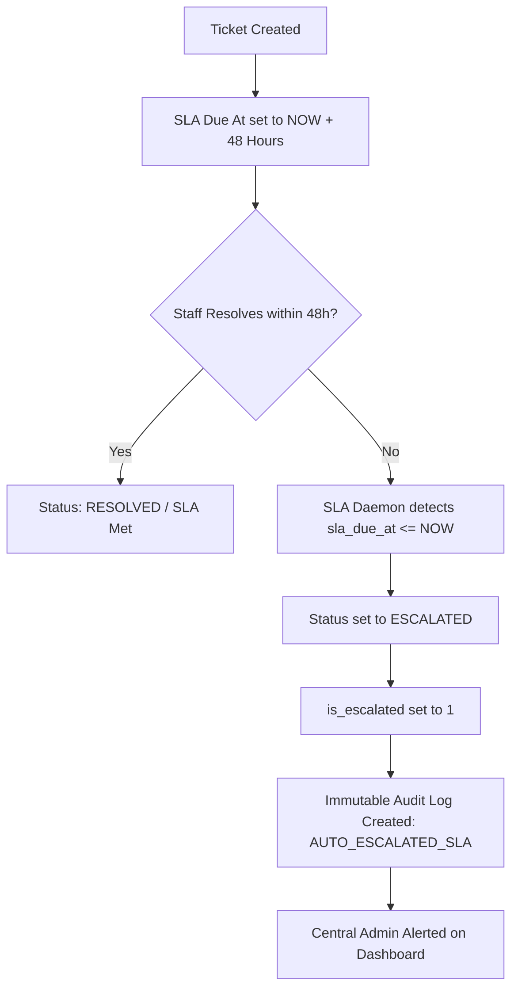

# University Complaint Management & Resolution System (UCMS)
## Complete System Architecture, File-by-File Technical Specification & Operational Manual

**Author:** Ahtisham Ijaz  
**Degree Programme:** BSc / BEng Computer Science & Software Engineering  
**Project Title:** University Complaint Management & Resolution System (UCMS)  
**Repository:** [https://github.com/AhtishamIjaz/University-Complaint-Management-Resolution-System-UCMS-](https://github.com/AhtishamIjaz/University-Complaint-Management-Resolution-System-UCMS-)  
**Docker Image:** `ahtishamijaz55/ucms:latest`  

---

## 📑 Table of Contents
1. [Executive Summary & System Purpose](#1-executive-summary--system-purpose)
2. [High-Level System Architecture](#2-high-level-system-architecture)
3. [Technology Stack & Architectural Justifications](#3-technology-stack--architectural-justifications)
4. [Relational Database Schema & Data Models](#4-relational-database-schema--data-models)
5. [Complete Directory Structure](#5-complete-directory-structure)
6. [Deep-Dive File-by-File Breakdown](#6-deep-dive-file-by-file-breakdown)
   - [6.1 Root Configuration & Orchestration Files](#61-root-configuration--orchestration-files)
   - [6.2 Backend Architecture (`server/`)](#62-backend-architecture-server)
   - [6.3 Frontend Architecture (`client/`)](#63-frontend-architecture-client)
7. [Core Technical Workflows & Algorithms](#7-core-technical-workflows--algorithms)
   - [7.1 Role-Based Access Control (RBAC)](#71-role-based-access-control-rbac)
   - [7.2 Automated 48-Hour SLA Escalation Daemon](#72-automated-48-hour-sla-escalation-daemon)
   - [7.3 Anonymous Grievance Protection Mechanism](#73-anonymous-grievance-protection-mechanism)
   - [7.4 Immutable Audit Logging System](#74-immutable-audit-logging-system)
   - [7.5 Business Intelligence & Satisfaction Metrics](#75-business-intelligence--satisfaction-metrics)
8. [RESTful API Specification](#8-restful-api-specification)
9. [How to Run & Deploy the System](#9-how-to-run--deploy-the-system)
10. [Supervisor Demonstration & Viva Presentation Script](#10-supervisor-demonstration--viva-presentation-script)

---

## 1. Executive Summary & System Purpose

The **University Complaint Management & Resolution System (UCMS)** is an institutional-grade, full-stack web platform engineered to eliminate informal, fragmented grievance channels (such as unmonitored emails, paper suggestion boxes, or verbal complaints) in higher education institutions.

The platform unifies the entire grievance lifecycle into a single, verifiable workflow:
$$\text{Submission} \longrightarrow \text{Automated Department Routing} \longrightarrow \text{Staff Investigation} \longrightarrow \text{SLA Compliance / Escalation} \longrightarrow \text{Resolution} \longrightarrow \text{Student Satisfaction Audit}$$

UCMS satisfies six foundational objectives:
- **Centralisation (O1):** A single web portal serving Students, Department Staff, and Central Administration.
- **Transparency (O2):** Real-time 4-stage visual progress stepper visible to the complainant.
- **Efficiency (O3):** Sub-second rule-based routing to responsible departments based on issue taxonomy.
- **Accountability (O4):** An immutable, append-only audit log tracking every actor and state transition.
- **Escalation Engine (O5):** An automated background daemon that escalates complaints breaching their 48-hour Service Level Agreement (SLA).
- **Business Intelligence (O6):** Real-time analytics dashboard monitoring departmental workload, resolution times, and student satisfaction score ($\ge 80\%$ benchmark).

---

## 2. High-Level System Architecture

The application adopts a **Decoupled Client-Server Tier** architecture that supports both unified containerised deployment and independent micro-service scaling.

```
+-----------------------------------------------------------------------------------+
|                                  USER LAYER                                       |
|  +-----------------------+  +-----------------------+  +-----------------------+  |
|  |    Student Portal     |  |  Staff / Dept Portal  |  |     Admin Portal      |  |
|  +-----------------------+  +-----------------------+  +-----------------------+  |
+------------------------------------------+----------------------------------------+
                                           | HTTPS / JSON
                                           v
+-----------------------------------------------------------------------------------+
|                           FRONTEND CLIENT TIER (React 18)                         |
|  - Vite Build Engine       - Tailwind CSS Styling       - Lucide Iconography      |
|  - AuthContext (JWT/State) - Axios API Interceptors     - Chart.js Visualizations |
|  - Dynamic Role Routing    - Quick Demo Switcher        - Timeline Stepper        |
+------------------------------------------+----------------------------------------+
                                           | REST API Requests (Bearer Token)
                                           v
+-----------------------------------------------------------------------------------+
|                            BACKEND SERVER TIER (Node.js / Express)                |
|  +---------------------+  +---------------------+  +---------------------------+  |
|  | Auth & RBAC Guard   |  | Multer File Storage |  | 48h SLA Escalation Engine |  |
|  +---------------------+  +---------------------+  +---------------------------+  |
|  +---------------------+  +---------------------+  +---------------------------+  |
|  | Ticket Controllers  |  | Department Routers  |  | Immutable Audit Logger    |  |
|  +---------------------+  +---------------------+  +---------------------------+  |
+------------------------------------------+----------------------------------------+
                                           | SQL Queries (ACID Transactions)
                                           v
+-----------------------------------------------------------------------------------+
|                               PERSISTENCE TIER (SQLite 3)                         |
|  - Users (RBAC)            - Departments           - Complaints (State Machine)   |
|  - Attachments (Metadata)  - Comments (Thread)     - Feedbacks (1-5 Star Ratings) |
|  - Audit Logs (Immutable Transaction History)                                     |
+-----------------------------------------------------------------------------------+
```

---

## 3. Technology Stack & Architectural Justifications

| Tier / Function | Technology | Version | Architectural Justification |
| :--- | :--- | :--- | :--- |
| **Frontend Framework** | React.js | `18.3.1` | Component-based reactive UI; virtual DOM delivers instantaneous updates during ticket state changes and live message threads. |
| **Build Tool** | Vite | `8.3.0` | Ultra-fast Hot Module Replacement (HMR) and optimized Rollup tree-shaking for minimal bundle footprint. |
| **Styling Engine** | Tailwind CSS | `3.4.1` | Utility-first CSS providing design consistency, mobile responsiveness, and high accessibility without CSS bloat. |
| **Icons** | Lucide React | `1.16.0` | Clean SVG iconography for status badges, timeline markers, and administrative controls. |
| **Data Visualization** | Chart.js & React-Chartjs-2 | `4.4.8` | Renders interactive Canvas-based bar charts, doughnut charts, and trend lines for Objective O6 analytics. |
| **Backend Runtime** | Node.js | `20.x / 24.x` | Asynchronous, event-driven I/O model handles concurrent complaint submissions and comment polling without blocking. |
| **Server Framework** | Express.js | `5.2.1` | Minimal, battle-tested RESTful routing engine with robust middleware chaining. |
| **Database** | SQLite 3 | `6.0.1` | Embedded relational database providing full ACID transactions and zero-configuration portability on any OS without requiring external database servers. |
| **Authentication** | JSON Web Tokens (JWT) | `9.0.3` | Stateless cryptographic authentication; tokens contain user identity, role, and department claim. |
| **Password Hashing** | Bcrypt.js | `3.0.3` | One-way cryptographic adaptive hashing with salt rounds to protect stored user credentials. |
| **File Handling** | Multer | `2.4.0` | Multipart/form-data middleware handling document and image uploads with strict MIME-type and size validation. |
| **Containerization** | Docker & Docker Compose | `v29 / v5` | Multi-stage build packaging both frontend and backend into a single portable container (`666 MB`). |

---

## 4. Relational Database Schema & Data Models

The database schema enforces relational integrity via foreign key constraints (`PRAGMA foreign_keys = ON`).

```
 +--------------------+       +--------------------+       +--------------------+
 |    departments     |       |       users        |       |     feedbacks      |
 +--------------------+       +--------------------+       +--------------------+
 | id (PK)            |<---+  | id (PK)            |<---+  | id (PK)            |
 | name (UNIQUE)      |    +--| department_id (FK) |    +--| complaint_id (FK)  |
 | code (UNIQUE)      |       | name               |    +--| student_id (FK)    |
 | description        |       | email (UNIQUE)     |    |  | rating (1-5)       |
 | email              |       | password_hash      |    |  | comment            |
 | created_at         |       | role               |    |  | created_at         |
 +--------------------+       | student_id         |    |  +--------------------+
          ^                   | phone              |    |
          |                   | created_at         |    |
          |                   +--------------------+    |
          |                             ^               |
          |                             |               |
 +--------+-----------------------------+---------------+-----------------------+
 |                                 complaints                                   |
 +------------------------------------------------------------------------------+
 | id (PK)                                                                      |
 | ticket_number (TEXT, UNIQUE, e.g. 'UCMS-2026-0001')                          |
 | title (TEXT)                                                                 |
 | description (TEXT)                                                           |
 | category (TEXT)                                                              |
 | priority (TEXT: 'LOW', 'MEDIUM', 'HIGH', 'URGENT')                           |
 | status (TEXT: 'PENDING', 'IN_PROGRESS', 'ESCALATED', 'RESOLVED', 'CLOSED')   |
 | is_anonymous (INTEGER: 0 or 1)                                               |
 | student_id (FK -> users.id)                                                  |
 | department_id (FK -> departments.id)                                         |
 | assigned_staff_id (FK -> users.id, NULLABLE)                                 |
 | sla_due_at (DATETIME)                                                        |
 | is_escalated (INTEGER: 0 or 1)                                               |
 | escalated_at (DATETIME, NULLABLE)                                            |
 | resolution_notes (TEXT, NULLABLE)                                            |
 | resolved_at (DATETIME, NULLABLE)                                             |
 | created_at (DATETIME)                                                        |
 | updated_at (DATETIME)                                                        |
 +------------------------------------------------------------------------------+
          |                             |                               |
          v                             v                               v
 +--------------------+       +--------------------+       +--------------------+
 |    attachments     |       |      comments      |       |     audit_logs     |
 +--------------------+       +--------------------+       +--------------------+
 | id (PK)            |       | id (PK)            |       | id (PK)            |
 | complaint_id (FK)  |       | complaint_id (FK)  |       | complaint_id (FK)  |
 | file_name          |       | user_id (FK)       |       | action             |
 | file_path          |       | message            |       | performed_by (FK)  |
 | file_type          |       | is_internal        |       | old_value          |
 | file_size          |       | created_at         |       | new_value          |
 | uploaded_at        |       +--------------------+       | details            |
 +--------------------+                                    | created_at         |
                                                           +--------------------+
```

---

## 5. Complete Directory Structure

```
UCMS/
├── .dockerignore                 # Excludes node_modules, logs, and build artifacts from Docker context
├── .gitignore                    # Prevents node_modules, temp files, and local DB from entering Git
├── Dockerfile                    # Multi-stage container recipe (Builds React SPA + bundles Express server)
├── docker-compose.yml            # One-command Docker deployment definition with volume persistence
├── package.json                  # Root runner scripts (npm start, npm run client, npm run server)
├── run.js                        # Zero-dependency Node.js process launcher (spawns client & server)
├── start_ucms.bat                # 1-click Windows batch script launcher
├── README.md                     # High-level overview, objectives alignment, and quickstart
├── DOCKER_GUIDE.md               # Step-by-step guide on Docker Hub distribution & offline .tar sharing
├── ARCHITECTURE_AND_MANUAL.md    # This complete architectural & technical reference document
│
├── server/                       # Express.js REST API Backend
│   ├── package.json              # Backend dependencies (express, sqlite3, bcryptjs, jsonwebtoken, etc.)
│   ├── test_api.js               # Automated end-to-end API verification test suite
│   ├── ucms.db                   # SQLite relational database file (auto-generated & auto-seeded)
│   ├── uploads/                  # Storage folder for student-uploaded evidence documents & images
│   └── src/
│       ├── server.js             # Express application entry, static hosting, and SLA interval timer
│       ├── seed.js               # Database seeder populating realistic university departments & tickets
│       ├── config/
│       │   └── db.js             # SQLite database connection, table initialization & promisified helpers
│       ├── controllers/
│       │   ├── adminController.js      # User creation, rerouting, SLA manual triggers, global audit
│       │   ├── authController.js       # Register, login, token issuance, demo account provider
│       │   ├── complaintController.js  # Ticket CRUD, status transition, comments, feedback rating
│       │   ├── departmentController.js # Department listings, department staff query, creation
│       │   └── statsController.js      # Business Intelligence aggregation for charts & KPIs
│       ├── middleware/
│       │   ├── authMiddleware.js       # JWT validation & user injection
│       │   ├── rbacMiddleware.js       # Role authorization gatekeeper
│       │   └── uploadMiddleware.js     # Multer file upload validation (10MB limit, file-type filters)
│       ├── routes/
│       │   ├── adminRoutes.js          # /api/admin endpoints
│       │   ├── authRoutes.js           # /api/auth endpoints
│       │   ├── complaintRoutes.js      # /api/complaints endpoints
│       │   ├── departmentRoutes.js     # /api/departments endpoints
│       │   └── statsRoutes.js          # /api/stats endpoints
│       └── services/
│           ├── auditService.js         # Immutable audit recording service
│           └── escalationService.js    # 48-Hour SLA check algorithm
│
└── client/                       # React 18 + Vite Frontend Application
    ├── package.json              # Client dependencies (react, tailwindcss, lucide-react, chart.js, etc.)
    ├── vite.config.js            # Vite bundler configuration
    ├── tailwind.config.js        # Tailwind CSS design system and theme extension
    ├── postcss.config.js         # PostCSS configuration for Tailwind
    ├── index.html                # HTML5 entry template with viewport configuration
    └── src/
        ├── main.jsx              # React DOM mounting entry
        ├── App.jsx               # Root layout, dynamic role router, and persistent footer
        ├── index.css             # Tailwind base, components, and utilities definitions
        ├── context/
        │   └── AuthContext.jsx   # Global auth state, session caching, and 1-click persona switcher
        ├── services/
        │   └── api.js            # Axios client with bearer token interceptor & dynamic host detection
        ├── components/
        │   ├── Navbar.jsx        # Navigation header with 1-click role switcher and notifications
        │   ├── StatusBadge.jsx   # Color-coded visual badges for PENDING, IN_PROGRESS, ESCALATED, etc.
        │   ├── PriorityBadge.jsx # Visual urgency indicators (LOW, MEDIUM, HIGH, URGENT)
        │   └── TimelineStepper.jsx # Real-time 4-step progress stepper (Objective O2)
        └── pages/
            ├── Login.jsx         # Login screen with instant demo credentials
            ├── Register.jsx      # Student registration form
            ├── StudentDashboard.jsx    # Student complaint list, KPI cards, filters, and search
            ├── NewComplaint.jsx        # Grievance submission form (attachments + anonymous toggle)
            ├── ComplaintDetails.jsx    # Ticket detail, comment thread, staff action, and feedback
            ├── StaffDashboard.jsx      # Department inbox, claim ticket workflow, and status updater
            ├── AdminDashboard.jsx      # Master complaints table, SLA manual trigger, and rerouter
            ├── AnalyticsPage.jsx       # Chart.js BI charts (Objective O6 satisfaction benchmark)
            ├── AuditLogsPage.jsx       # Complete immutable system audit trail (Objective O4)
            └── DepartmentManagePage.jsx # Department and staff onboarding manager
```

---

## 6. Deep-Dive File-by-File Breakdown

### 6.1 Root Configuration & Orchestration Files

#### `Dockerfile`
- **Purpose:** Multi-stage container recipe.
- **Stage 1 (`client-builder`):** Installs frontend dependencies and executes `npm run build`, producing an optimized production bundle in `client/dist`.
- **Stage 2 (Runtime):** Utilizes `node:20-alpine`, installs native compilation tools (`make`, `g++`, `python3`) required for compiling native SQLite bindings, installs production server packages, copies `client/dist` into `/app/server/public`, and exposes port `5000`.
- **Outcome:** A self-contained image (`666 MB`) that hosts both the API and frontend simultaneously.

#### `docker-compose.yml`
- **Purpose:** Declarative container orchestration.
- **Configuration:** Maps host port `5000` to container port `5000`, injects production environment variables (`NODE_ENV=production`, `PORT=5000`, `JWT_SECRET`), and configures a persistent named volume `ucms_storage` mapped to `/app/server/uploads` to ensure user uploads survive container restarts.

#### `.dockerignore`
- **Purpose:** Prevents local files from bloating the Docker build context.
- **Rules:** Excludes `node_modules`, `.git`, `.env`, temporary logs, and previous local builds.

#### `package.json` (Root)
- **Purpose:** Root workflow coordinator.
- **Scripts:**
  - `"start"`: Invokes `node run.js`.
  - `"server"`: Starts the backend standalone (`npm --prefix server start`).
  - `"client"`: Starts the Vite dev server (`npm --prefix client dev`).
  - `"seed"`: Manually runs the backend seeder.

#### `run.js`
- **Purpose:** Zero-dependency cross-platform process runner.
- **Mechanism:** Uses Node.js native `child_process.spawn` to concurrently execute `npm start` in `server/` and `npm run dev` in `client/`. Detects Windows OS (`npm.cmd`) vs Linux/macOS (`npm`) and cleanly forwards `SIGINT`/`SIGTERM` signals to terminate child processes when stopping.

#### `start_ucms.bat`
- **Purpose:** 1-Click execution script for Windows environments.
- **Mechanism:** Launches `node run.js` and keeps the terminal window open for logs.

#### `README.md` & `DOCKER_GUIDE.md`
- **Purpose:** User-facing documentation explaining project goals, credentials, Docker Hub deployment, and offline `.tar` image distribution.

---

### 6.2 Backend Architecture (`server/`)

#### `server/package.json`
- **Purpose:** Backend dependency manifest.
- **Dependencies:**
  - `express`: Core web server framework.
  - `sqlite3`: Relational database engine.
  - `bcryptjs`: Password salt & hash library.
  - `jsonwebtoken`: Stateless JWT token generation & verification.
  - `multer`: Multi-part file upload processing.
  - `cors`: Cross-Origin Resource Sharing handling.
  - `dotenv`: Environment variable configuration.

#### `server/src/server.js`
- **Purpose:** Main application entry point.
- **Responsibilities:**
  1. Boots Express application on port `5000`.
  2. Initializes database schema via `initDB()`.
  3. Seeds initial realistic data via `seedData()`.
  4. Mounts static upload serving at `/uploads`.
  5. Mounts API routes (`/api/auth`, `/api/complaints`, `/api/departments`, `/api/admin`, `/api/stats`).
  6. **Static SPA Serving:** Detects if compiled frontend assets exist in `public/` (Docker) or `../client/dist` (local) and serves them with an Express 5 compatible SPA fallback middleware.
  7. **SLA Daemon:** Runs `setInterval` executing `checkAndEscalateTickets()` every 5 minutes.

#### `server/src/config/db.js`
- **Purpose:** SQLite database connection manager and schema migration engine.
- **Key Functions:**
  - Promisified SQL query wrappers: `run(sql, params)`, `get(sql, params)`, `all(sql, params)`.
  - `initDB()`: Enables foreign key enforcement and creates tables (`departments`, `users`, `complaints`, `attachments`, `comments`, `audit_logs`, `feedbacks`) with appropriate data types, default values, and foreign key constraints.

#### `server/src/seed.js`
- **Purpose:** Generates a realistic university ecosystem for demonstration and assessment.
- **Seeded Entities:**
  - **5 Departments:** ITS, Facilities, Academic Affairs, Finance, Student Affairs.
  - **Admin User:** Dr. Sarah Harrison (`admin@ucms.edu` / `Admin@123`).
  - **4 Department Staff:** Marcus Vance (IT), Robert Chen (Facilities), Prof. Evelyn Reed (Academics), David Miller (Finance).
  - **3 Students:** Alice Johnson (CS), Bilal Khan (SE), Emma Watson (EE).
  - **6 Diverse Complaints:** Including an active IT issue with chat messages, an overdue hostel maintenance ticket escalated by SLA, an academic grade dispute resolved with 5-star student review, a finance fee refund ticket, an anonymous harassment grievance, and a newly submitted pending ticket.

#### `server/src/middleware/authMiddleware.js`
- **Purpose:** Cryptographic JWT token verifier.
- **Mechanism:** Extracts Bearer token from `Authorization` header, verifies signature against `JWT_SECRET`, and attaches decoded user claims (`id`, `name`, `email`, `role`, `department_id`, `student_id`) to `req.user`.

#### `server/src/middleware/rbacMiddleware.js`
- **Purpose:** Role-Based Access Control gatekeeper.
- **Function:** `authorize(allowedRoles)` ensures only users whose `req.user.role` matches the allowed role list (e.g., `['admin']` or `['staff', 'admin']`) can proceed, returning HTTP 403 Forbidden otherwise.

#### `server/src/middleware/uploadMiddleware.js`
- **Purpose:** File attachment upload handler.
- **Configuration:** Uses `multer.diskStorage` to save uploaded files with unique timestamps in `server/uploads/`. Enforces a 10MB size limit and restricts extensions to images (`jpg`, `png`, `webp`, `gif`), documents (`pdf`, `doc`, `docx`), and text (`txt`).

#### `server/src/services/escalationService.js`
- **Purpose:** Automated SLA enforcement engine (Objective O5).
- **Algorithm:** Queries all complaints where `status IN ('PENDING', 'IN_PROGRESS')` AND `sla_due_at <= datetime('now')` AND `is_escalated = 0`. For each matching ticket, it transitions `status = 'ESCALATED'`, records `is_escalated = 1`, and creates an immutable audit log entry documenting that the 48-hour SLA deadline expired.

#### `server/src/services/auditService.js`
- **Purpose:** Immutable audit record generator (Objective O4).
- **Key Functions:**
  - `logAction(...)`: Writes an append-only entry into `audit_logs` storing complaint ID, action name, user ID, old state, new state, and narrative explanation.
  - `getTicketAuditLogs(complaintId)`: Retrieves chronological history for a specific complaint with author names and roles.

#### `server/src/controllers/authController.js`
- **Responsibilities:**
  - `register`: Validates user details, hashes password via bcrypt, assigns student role, and issues JWT.
  - `login`: Compares bcrypt hash, retrieves department information, and returns JWT.
  - `getMe`: Returns current user profile.
  - `getDemoAccounts`: Supplies pre-configured credentials for the 1-click role switcher.

#### `server/src/controllers/complaintController.js`
- **Responsibilities:**
  - `createComplaint`: Generates sequential ticket identifier (`UCMS-2026-XXXX`), calculates 48-hour SLA due timestamp (`datetime('now', '+48 hours')`), handles multi-file attachments, and logs initial audit record.
  - `getComplaints`: Role-aware ticket query:
    - Students see only their own complaints.
    - Staff see complaints routed to their department.
    - Admins see complaints across all departments.
    - Masks complainant name as "Anonymous Student" if `is_anonymous = 1` and viewer is not admin.
  - `getComplaintById`: Returns ticket metadata, attachments, comments thread, audit trail, and satisfaction feedback.
  - `updateStatus`: Allows staff/admin to transition status and mandates resolution remarks when marking as `RESOLVED`.
  - `assignStaff`: Allows staff to self-claim or admin to delegate tickets.
  - `addComment`: Appends messages to the complaint clarification thread.
  - `submitFeedback`: Allows complainant to submit a 1 to 5 star rating and review after resolution.

#### `server/src/controllers/departmentController.js`
- **Responsibilities:**
  - `getAllDepartments`: Returns all departments aggregated with live counts of total, pending, escalated, and resolved complaints, plus staff count.
  - `createDepartment`: Allows admin to register new academic/operational departments.
  - `getDepartmentStaff`: Returns all staff assigned to a specific department.

#### `server/src/controllers/adminController.js`
- **Responsibilities:**
  - `getUsers` & `createUser`: Manages university staff and administrator onboarding.
  - `triggerEscalationCheck`: On-demand execution of `checkAndEscalateTickets()` for live supervisor presentation.
  - `getAuditLogs`: Queries global system audit logs with search and action filtering.
  - `reassignComplaint`: Allows central administration to reroute misplaced tickets to another department.

#### `server/src/controllers/statsController.js`
- **Responsibilities:**
  - Calculates institutional KPIs for Objective O6:
    - Total grievances, pending, in-progress, escalated, and resolved counts.
    - Resolution rate percentage: $\frac{\text{Resolved}}{\text{Total}} \times 100$.
    - Average resolution duration in hours: $\text{AVG}(\text{resolved\_at} - \text{created\_at})$.
    - Student satisfaction score percentage: $\frac{\text{Ratings} \ge 4}{\text{Total Ratings}} \times 100$ against the $\ge 80\%$ benchmark.
    - Departmental breakdown datasets for Chart.js bar charts.
    - Status distribution datasets for doughnut charts.
    - Category breakdown datasets.
    - Daily/weekly submission and resolution trend lines.

#### `server/test_api.js`
- **Purpose:** Automated CLI test runner verifying backend health, authentication, role-based scoping, SLA manual triggers, and analytics calculation.

---

### 6.3 Frontend Architecture (`client/`)

#### `client/package.json`
- **Purpose:** Frontend dependencies specification including `react`, `react-dom`, `axios`, `chart.js`, `react-chartjs-2`, `lucide-react`, and `tailwindcss`.

#### `client/vite.config.js` & `client/tailwind.config.js`
- **Purpose:** Bundler and styling configurations defining content scanning paths (`./src/**/*.{js,jsx}`) and brand color palettes.

#### `client/src/services/api.js`
- **Purpose:** Centralized Axios instance with request and response interceptors.
- **Dynamic Host Detection:** If the client is running on port `5173` (Vite dev server), it targets `http://localhost:5000/api`. If served inside Docker or production, it targets `/api` relatively. Automatically attaches `Authorization: Bearer <token>` from `localStorage`.

#### `client/src/context/AuthContext.jsx`
- **Purpose:** React context managing user authentication state across the application.
- **Key Features:**
  - Caches JWT token and user profile in `localStorage`.
  - Exposes `login`, `register`, `logout`, and `switchRole(roleKey)`.
  - `switchRole` enables **1-Click Demo Switching** between Student (Alice), IT Staff (Marcus), Facility Staff (Robert), and Admin (Dean) without retyping credentials.

#### `client/src/components/Navbar.jsx`
- **Purpose:** Persistent top navigation bar.
- **Features:**
  - Houses the **1-Click Role Switcher** ribbon at the top.
  - Displays dynamic navigation tabs based on user role (`role === 'student'`, `'staff'`, or `'admin'`).
  - Displays active user badge, department tag, and logout action.

#### `client/src/components/StatusBadge.jsx` & `PriorityBadge.jsx`
- **Purpose:** Visual indicators rendering color-coded badges with Lucide icons for complaint statuses (`PENDING`, `IN_PROGRESS`, `ESCALATED`, `RESOLVED`, `CLOSED`) and priority levels (`LOW`, `MEDIUM`, `HIGH`, `URGENT`).

#### `client/src/components/TimelineStepper.jsx`
- **Purpose:** Implements Objective O2 (Real-Time Transparency).
- **Features:** Horizontal 4-step progress stepper displaying:
  1. **Submitted:** Timestamp of receipt.
  2. **Under Review:** Department investigation indicator.
  3. **SLA Compliance:** Highlights in emerald if on track, or pulses in rose red if escalated.
  4. **Resolved:** Resolution timestamp and outcome.

#### `client/src/pages/Login.jsx` & `Register.jsx`
- **Purpose:** Authentication pages featuring standard login/register inputs alongside 1-click quick login buttons for all personas.

#### `client/src/pages/StudentDashboard.jsx`
- **Purpose:** Complainant workspace.
- **Features:** Summary counters (Total, Pending, In Progress, Escalated, Resolved), search bar, status filter buttons, and list of student-filed complaints with SLA countdown badges and direct links to details.

#### `client/src/pages/NewComplaint.jsx`
- **Purpose:** Complaint filing form.
- **Features:** Title input, category selector with auto-department suggestion, priority radio buttons, multi-file attachment dropzone, and an **Anonymous Filing Toggle** with explanatory security disclaimer.

#### `client/src/pages/ComplaintDetails.jsx`
- **Purpose:** Comprehensive single-ticket resolution view.
- **Features:**
  - Header metadata, SLA deadline banner, and `TimelineStepper`.
  - Full problem narrative and clickable attachment downloads.
  - Official resolution remarks panel.
  - Interactive discussion thread between student and department staff.
  - Staff management panel (claim ticket, change status, input resolution notes).
  - Student satisfaction survey (1 to 5 stars + review comment).
  - Tab toggling between the live message thread and the immutable audit log.

#### `client/src/pages/StaffDashboard.jsx`
- **Purpose:** Departmental resolution queue.
- **Features:** Filterable inbox scoped to the staff member's department, "Assigned to Me" quick toggle, priority badges, and direct status update workflows.

#### `client/src/pages/AdminDashboard.jsx`
- **Purpose:** Central university oversight portal.
- **Features:**
  - Master ticket data table displaying all university complaints.
  - **"⚡ Trigger SLA Check Now"** button to force immediate execution of the SLA escalation engine.
  - Department rerouting modal allowing administrators to reassign misplaced tickets with a required audit reason.

#### `client/src/pages/AnalyticsPage.jsx`
- **Purpose:** Executive BI dashboard satisfying Objective O6.
- **Visuals:**
  - Stacked bar chart of complaint volume by department.
  - Doughnut chart of resolution lifecycle status breakdown.
  - Category distribution chart.
  - Student satisfaction breakdown with star distribution and percentage calculation proving the $\ge 80\%$ benchmark.
  - Inflow and resolution trend lines over time.

#### `client/src/pages/AuditLogsPage.jsx`
- **Purpose:** System-wide immutable compliance log satisfying Objective O4.
- **Features:** Searchable, filterable tabular audit trail showing timestamp, ticket number, action type, actor name, actor role, old value $\rightarrow$ new value transition, and narrative description.

#### `client/src/pages/DepartmentManagePage.jsx`
- **Purpose:** Department and personnel management.
- **Features:** Grid cards for all departments showing live complaint metrics, modal for creating new departments, and modal for onboarding department staff.

#### `client/src/App.jsx`
- **Purpose:** Root application component that wires `AuthProvider`, checks session status, selects the active view based on role and tab state, and renders the university footer.

---

## 7. Core Technical Workflows & Algorithms

### 7.1 Role-Based Access Control (RBAC)

The system enforces three authorization layers:
1. **Database Layer:** `users.role` check constraint (`CHECK(role IN ('student', 'staff', 'admin'))`).
2. **Backend API Middleware:** `rbacMiddleware.js` intercepts every protected endpoint. If an unprivileged token attempts an administrative operation, the request is halted with HTTP 403.
3. **Frontend UI Tier:** The React client dynamically hides unauthorized views and navigation tabs based on the active decoded JWT role.

---

### 7.2 Automated 48-Hour SLA Escalation Daemon

The escalation algorithm enforces institutional accountability:

$$\text{Condition: } (\text{status} \in \{\text{'PENDING'}, \text{'IN\_PROGRESS'}\}) \land (\text{sla\_due\_at} \le \text{NOW}) \land (\text{is\_escalated} = 0)$$



---

### 7.3 Anonymous Grievance Protection Mechanism

When a complainant files a sensitive complaint (such as harassment or bullying) with `is_anonymous = 1`:
1. The database records the real `student_id` internally to preserve referential integrity and enable the student to view their own ticket.
2. In all queries executed by Department Staff or peer students, the SQL serializer sanitizes the complainant data:
   - `student_name` $\rightarrow$ `"Anonymous Complainant"`
   - `student_reg_no` $\rightarrow$ `"REDACTED"`
   - `student_email` $\rightarrow$ `"anonymous@ucms.edu"`
3. In message threads, author names for student comments are masked to prevent identity leakage.
4. Only Central Administration possesses cryptographic permission to view the complainant's identity in cases requiring legal intervention.

---

### 7.4 Immutable Audit Logging System

Every modification to a complaint triggers an append-only entry in `audit_logs`:

$$\text{Audit Entry} = \{\text{id}, \text{complaint\_id}, \text{action}, \text{actor\_id}, \text{old\_value}, \text{new\_value}, \text{details}, \text{timestamp}\}$$

No `UPDATE` or `DELETE` SQL commands exist for `audit_logs`. This satisfies institutional governance requirements, preventing staff from retroactively altering timestamps or masking delays.

---

### 7.5 Business Intelligence & Satisfaction Metrics

The analytics engine computes key operational metrics:

1. **Resolution Rate:**
   $$\text{Resolution Rate} = \left( \frac{N_{\text{Resolved}} + N_{\text{Closed}}}{N_{\text{Total}}} \right) \times 100$$

2. **Average Resolution Time (Hours):**
   $$\bar{T}_{\text{resolution}} = \frac{1}{N_{\text{Resolved}}} \sum_{i=1}^{N_{\text{Resolved}}} \frac{\text{epoch}(\text{resolved\_at}_i) - \text{epoch}(\text{created\_at}_i)}{3600}$$

3. **Student Satisfaction Score (Target $\ge 80\%$):**
   $$\text{Satisfaction Score} = \left( \frac{N_{\text{Rating} \ge 4}}{N_{\text{Total Feedbacks}}} \right) \times 100$$

---

## 8. RESTful API Specification

### Authentication (`/api/auth`)
| Method | Endpoint | Access | Description |
| :--- | :--- | :--- | :--- |
| `POST` | `/api/auth/register` | Public | Registers a new student account |
| `POST` | `/api/auth/login` | Public | Authenticates credentials and returns JWT |
| `GET` | `/api/auth/me` | Authenticated | Retrieves profile of currently authenticated user |
| `GET` | `/api/auth/demo-accounts` | Public | Supplies pre-seeded demo personas |

### Complaints (`/api/complaints`)
| Method | Endpoint | Access | Description |
| :--- | :--- | :--- | :--- |
| `POST` | `/api/complaints` | Student / Admin | Submits a new grievance with optional multi-file attachments |
| `GET` | `/api/complaints` | Authenticated | Retrieves complaints scoped to user role |
| `GET` | `/api/complaints/:id` | Authenticated | Retrieves detailed complaint record, attachments, and thread |
| `PATCH` | `/api/complaints/:id/status` | Staff / Admin | Updates ticket status (`IN_PROGRESS`, `RESOLVED`, `CLOSED`) |
| `PATCH` | `/api/complaints/:id/assign` | Staff / Admin | Assigns ticket to a staff member |
| `POST` | `/api/complaints/:id/comments` | Authenticated | Posts a message to the complaint clarification thread |
| `POST` | `/api/complaints/:id/feedback` | Student | Submits post-resolution satisfaction rating (1-5 stars) |

### Departments (`/api/departments`)
| Method | Endpoint | Access | Description |
| :--- | :--- | :--- | :--- |
| `GET` | `/api/departments` | Authenticated | Lists all departments with aggregate ticket metrics |
| `POST` | `/api/departments` | Admin | Creates a new university department |
| `GET` | `/api/departments/:id/staff` | Authenticated | Lists all staff members belonging to a department |

### Administration & Escalation (`/api/admin`)
| Method | Endpoint | Access | Description |
| :--- | :--- | :--- | :--- |
| `GET` | `/api/admin/users` | Admin | Lists registered users filtered by role or department |
| `POST` | `/api/admin/users` | Admin | Onboards a new staff or admin user |
| `POST` | `/api/admin/escalate-now` | Admin | Manually triggers the 48-hour SLA escalation check |
| `GET` | `/api/admin/audit-logs` | Admin | Returns global immutable audit log records |
| `PATCH` | `/api/admin/reassign/:id` | Admin | Reroutes a complaint to a different department |

### Business Intelligence (`/api/stats`)
| Method | Endpoint | Access | Description |
| :--- | :--- | :--- | :--- |
| `GET` | `/api/stats/analytics` | Staff / Admin | Returns KPI metrics, charts data, and satisfaction scores |

---

## 9. How to Run & Deploy the System

### Option 1: Native Windows Launch (No Docker Required)
1. Double-click the file [**`start_ucms.bat`**](file:///C:/Users/NexGen/Desktop/UCMS/start_ucms.bat).
2. Alternatively, run:
   ```bash
   cd C:\Users\NexGen\Desktop\UCMS
   npm start
   ```
3. Open [http://localhost:5173](http://localhost:5173) in your browser.

---

### Option 2: Run via Docker Container (Single Command)
Ensure Docker Desktop is running, then execute:
```bash
docker run -d -p 5000:5000 --name ucms-app ahtishamijaz55/ucms:latest
```
Open [http://localhost:5000](http://localhost:5000) in your browser.

---

### Option 3: Run via Docker Compose
In the `UCMS` root directory:
```bash
docker compose up -d
```
Open [http://localhost:5000](http://localhost:5000).

---

## 10. Supervisor Demonstration & Viva Presentation Script

When demonstrating the project during your Final Year Project evaluation:

1. **Introduction:** Open `http://localhost:5000` and highlight that the application is running from a multi-stage Docker container (`ahtishamijaz55/ucms:latest`).
2. **Student Workflow:**
   - Click **`👨‍🎓 Student (Alice)`** on the 1-Click Role Switcher.
   - Show the **Student Dashboard** with KPI counters and the complaint list.
   - Click **Submit New Complaint**. Select category "IT Services", priority "High", and explain how the department is automatically routed to ITS.
   - Highlight the **Anonymous Filing** toggle and explain how it protects students reporting sensitive harassment.
   - Open ticket `UCMS-2026-0001` to demonstrate the **Real-Time Timeline Stepper** (Objective O2) and post a live message in the discussion thread.
3. **Staff Workflow:**
   - Click **`🛠️ IT Staff (Marcus)`** on the role switcher.
   - Show how the inbox is strictly filtered to IT department complaints.
   - Open the ticket, show that the student's message is visible, and demonstrate updating the status to `RESOLVED` with formal resolution remarks.
4. **Student Satisfaction Rating:**
   - Switch back to **`👨‍🎓 Student (Alice)`**, open the resolved ticket, and demonstrate submitting a **5-star satisfaction rating** with review notes.
5. **Admin Oversight & SLA Escalation:**
   - Click **`🏛️ Admin (Dean)`**.
   - Show the **Master Ticket Table** and explain cross-department visibility.
   - Click the **`⚡ Trigger SLA Check Now`** button to demonstrate the **Automated 48-Hour SLA Escalation Engine** (Objective O5).
   - Point out ticket `UCMS-2026-0002` (Hostel water heater failure), showing how it automatically escalated to Central Administration because the department failed to resolve it within 48 hours.
6. **Governance & Audit Trail:**
   - Click the **Audit Trail** tab to show Objective O4 (Immutable Audit Log) proving every action, actor, and timestamp is permanently recorded.
7. **Analytics & Performance:**
   - Click the **Analytics** tab to show Objective O6 (Chart.js charts for department volume, status breakdown, and satisfaction benchmark $\ge 80\%$).
